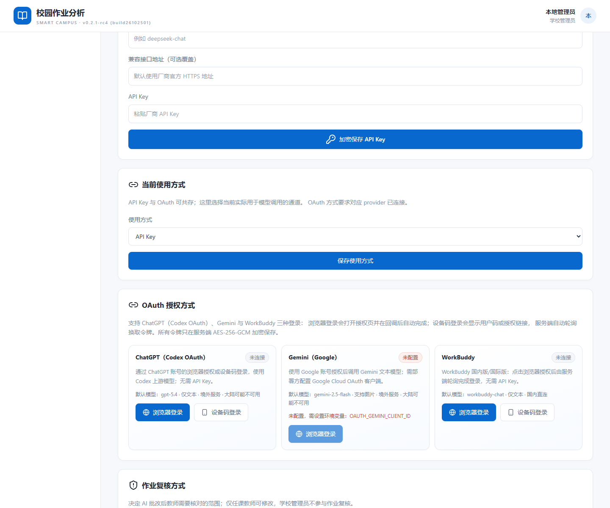

# 校园作业分析 · Smart Campus Homework Analyzer

[](https://github.com/turtlelnc/MES-Homework/releases)
[](https://github.com/turtlelnc/MES-Homework/releases)
[](https://github.com/turtlelnc/MES-Homework/actions)
[](LICENSE)
[](SECURITY_REVIEW.md)
[](tools/deployer/README.md)
[](tools/installer/README.md)
[](tools/deployer/README.md)
[](package.json)
[](https://github.com/deepseek-ai/deepseek-harness)

**v0.2.1-rc4**（build26102501）｜ MIT License

[English](README.EN.md) | 中文

校园作业分析器：上传作业，AI 识别批改，教师复核后自动生成班级学情、知识点掌握率、错因统计与讲评课方案。所有数字由已复核数据确定性计算，AI 只负责转写成课堂语言。

---

这是可在学校或个人服务器运行的全栈版本。账户、学校、学生、知识库、作业、OCR、教师复核、错题本、试卷、家长看板与 AI 教学分析均使用持久化数据。

## v0.2.1 新增（v0.2.1-rc1 起）

### 1. 三种作业复核方式（教师自选）

教师可在「设置 → 作业复核方式」中选择：

- **全部复核**：每道题都由教师确认后才写入错题本（与旧版本一致，默认）。
- **仅存疑复核**：AI 高置信度、判分自洽的题目自动通过；教师只需要复核低置信度、无法辨认、分数异常或缺少判断逻辑的存疑题，界面默认只显示存疑题。
- **不复核**：AI 批改后直接完成并写入错题本，教师可随时重新识别覆盖。模型返回结构不完整时仍会退回人工复核，不会静默丢题。

### 2. 批改结果同时给出「为什么这么改」

识别与复核页、家长端答卷明细都会显示：逐题批改结果、教师参考答案、AI 判断逻辑（`reasoning`：对照答案要素、为什么判对/判错）。学生端不直接展示答案，见第 8 条。

### 3. API Key 之外新增 OAuth 授权链接模型

保留原有 10 个厂商的 API Key 方式，新增免 API Key 的 OAuth 登录（v0.2.1-rc4 起）：

- **ChatGPT（Codex OAuth）**：浏览器回调 + PKCE，或设备码（Device Code / Codex OAuth）。用户在浏览器点击授权即可，无需复制 API Key；中国大陆境内不可用，前端会先提示。
- **Gemini（Google）**：浏览器 OAuth + PKCE，部署管理员用 `OAUTH_GEMINI_CLIENT_ID/SECRET` 配置 Google OAuth 客户端。
- **WorkBuddy**：设备码/浏览器轮询登录（国内版默认，可切国际版），点击浏览器授权后服务端自动完成。

已移除 Claude、Qwen（国际版）、千问（国内版）、DeepSeek（Platform）的 OAuth 入口；这些厂商仍可用 API Key。OAuth 令牌在服务端 AES-256-GCM 加密存储，支持自动刷新、自动轮询与断开连接。详见 [docs/oauth-flows.md](docs/oauth-flows.md)。

### 4. 账号名 + 密码 + 身份选择注册

注册页先选择身份：**学校 / 老师 / 学生 / 家长**，再填写账号名、密码与对应资料；登录支持账号名或旧账号的邮箱。老师/学生/家长使用学校代码加入已有学校；家长绑定孩子需验证孩子账号与密码。可通过 `ALLOW_PUBLIC_REGISTRATION=0` 关闭自助注册、恢复由学校管理员统一建号。

### 5. 家长端

家长账号可查看已绑定孩子的看板：已复核作业数、平均得分率、错题与掌握率、学科表现、薄弱知识点、错因分布、成绩趋势、近期作业明细（含批改结果、参考答案与 AI 判断逻辑），并在「学情分析」中一键生成 AI 学情分析（优势、薄弱知识点、学习习惯、家庭配合动作与鼓励）。

### 6. 模型调用模式（由学校端设置）

学校管理员在「学校仪表盘」选择：

| 模式 | 谁配置模型凭证 | 学生端/家长端调用谁 |
| --- | --- | --- |
| 全校统一模式 | 仅学校管理员 | 学校统一凭证 |
| 老师分开 + 班费模式 | 每位老师配置自己的 OAuth / API Key | 本班班主任的凭证 |
| 老师分开 + 家长单独模式 | 每位老师、每位家长各自配置 | 学生用绑定家长的凭证，家长用本人凭证 |

学校端同时提供班级/班主任分配，用于「班费模式」定位本班班主任。切换模式立即生效。

### 7. 不需要先上传原题的「AI 直接批改」

新增作业时可选择「无需原题 · AI 直接批改」，只需填写作业名称与**非必填**的作业内容描述；学生上传答卷后，AI 自动切题、给出参考答案与评分要点、逐题批改并输出判断逻辑，教师按所选复核方式处理。原题库模式继续保留。

### 8. 学生错题本改为「引导思考」而不是直接给答案

学生端错题本不再直接展示订正答案与解析，而是：关键思考问题 → 逐条提示（不直接给答案）→ 重做原题（AI 判断是否掌握）→ 答对后对照参考答案与解析 → 同类过关练习。连续 3 次未掌握会给出参考答案兜底，避免卡死。

> 说明：AI 直接批改模式的作业使用逐卷解析出的题目快照，暂不参与班级「AI 教学分析」（该分析按全班同一套题号统计）；家长端学情分析不受影响。

### OAuth 模型链接配置（部署管理员）

OAuth 采用 Authorization Code + PKCE 与设备码（Device Code）两种流程，前端按 provider 支持的方式显示「浏览器登录」/「设备码登录」：

- **ChatGPT**：内置 Codex 公共 PKCE 客户端，无需配置 Client ID；浏览器登录自动监听 `http://localhost:1455/auth/callback`，设备码登录显示 `https://auth.openai.com/codex/device` 与一次性用户码。
- **Gemini**：在 Google Cloud 创建 OAuth 客户端（Desktop app），启用 Generative Language API，配置 `OAUTH_GEMINI_CLIENT_ID`、`OAUTH_GEMINI_CLIENT_SECRET`（scopes 见 `.env.example`）；未配置时显示「未配置」。
- **WorkBuddy**：内置官方授权流程，支持「浏览器登录」（直接打开授权页）与「设备码登录」（显示授权链接），两者底层同一官方轮询流程；`OAUTH_WORKBUDDY_REGION=cn|global` 选择国内版/国际版。

ChatGPT、Gemini 在中国大陆境内不可用，前端会在跳转前提示。OAuth 不影响的 API Key 方式继续可用。完整接口与安全约定见 [docs/oauth-flows.md](docs/oauth-flows.md)。



## v0.2.0-rc1 新增：AI 教学分析

面向教师课堂讲评的新板块，直接消费教师已经复核的错题，把“批改结果”变成“能上课的内容”。

- 班级学情画像：已复核答卷数、班级得分率、错题数与错因占比、无法辨认题目的单独提醒。
- 知识点掌握率：按题号聚合到校本知识点，从最薄弱开始排序，直接指出本节课要先补的漏洞。
- 错因归因：内置 12 类错因（概念混淆、审题偏差、计算粗心、步骤缺失、公式记忆不牢、条件遗漏等），先用关键词规则确定性归类，教师可再点“AI 重新归因”让模型结合题干与知识点复核；错因按题号严格划分，占比之和恒为 100%。
- 高频错题讲评单：按出错人数排序，展开即可看到出错学生、参考答案、分步解析、同类练习，以及 AI 生成的“讲给学生听 / 板书演示 / 讲完立刻检查”。
- 课堂讲评课方案：主题、课时、目标、时间轴（讲什么、教师做什么、学生做什么）与可照写的板书设计。
- 分层辅导与错因干预：每个错因配一个 5 分钟内可执行的课堂动作，并给出可直接点名的分层辅导名单。
- 课后作业：只针对本次出错的知识点，可一键把选中的高频错题生成新的重练作业。
- 学生跟进名单：标记“观察 / 跟进 / 重点”，一键生成该生的个别化诊断（薄弱知识点、错因剖析、补强动作、针对性练习、给家长的一段说明）。
- 导出：一键导出 Markdown 讲评单，或直接打印成 A4 讲评单带到课堂。

统计口径说明：只有教师在“识别与复核”确认过的错题进入统计；判为“无法辨认”的题目单独列出，不计入学生错因占比，避免因为扫描不清而误判学生掌握情况。

## 项目组

本项目作为中山梅沙实验学校的首届梅沙黑客松限时完成的参赛作品，获得了 **最高奖项（智创校园大奖）** 。
具体内容：[中山梅沙实验学校的公众号文章：36小时，我们见证了一场狂欢](https://mp.weixin.qq.com/s/H2DiIkaNx56Y_fUoRV-HzA)


B3组 校园作业分析器

导师：陈银香  
组员：欧阳进达、吴汶轩、胡以琳、程诺、黎敦文  
项目后期维护组（贡献者）：（WWX、CN、ZYH）
<a href="https://github.com/turtle-Owen">
  
</a>
<a href="https://github.com/Tom505915-Zhang">
  
</a>


## 安全性声明

本项目为 **DeepSeek V4.1-Flash** 与 **Qwen 3.8 Max**（在 DeepSeek Harness 上运行）和 **GPT 6 Sol**（在 Codex 上）辅助完成。所有 AI 生成的输出未由开发者仔细审核，开发者不对最终代码库和文档负责任。

详细的安全信息、负责任使用指南和数据隐私注意事项请参阅 [SAFETY.zh.md](SAFETY.zh.md)（[English](SAFETY.md)）。


## v0.2.1 能力

- 独立注册学校管理员账户；学校账户不设置学段、学科或班级，用于查看全校数据并创建教师、学生账户。
- 教师单个注册学生，或通过 CSV/XLSX 一次导入最多 500 名学生（支持“账号名”列，留空时自动生成）。
- 新增作业时可上传 JPG、PNG、WebP、PDF、DOCX 或 DOC：PDF 逐页 OCR，DOCX 提取正文、表格与内嵌图片，DOC 提取可读取文字，统一生成可编辑草稿。
- PDF 在服务器转成页面图像，不再要求用户手工转图。
- 学生作业上传后与正式题目严格对齐；OCR 建议经教师复核后才写入错题本。
- 作业导入会自动补充标准答案、评分要点和缺失知识点；教师主要进行抽查和修正。
- 错题自动生成分步解析与同类型练习，学生全部答对后标记知识点过关。
- 10 个模型厂商预设，API Key 在服务端使用 AES-256-GCM 加密。
- 更改教师复核作业的逻辑为可以让教师设置全部复核、仅存疑复核、不复核
- AI批改作业后，既要出现批改结果和参考答案，还要显示为什么这么改（AI批改时的判断逻辑）
- 保留原来通过 API Key 链接大模型的同时，增加通过 OAuth 登录模型（ChatGPT Codex OAuth 浏览器/设备码、Gemini Google OAuth、WorkBuddy 设备码/浏览器轮询；v0.2.1-rc4 起移除 Claude/Qwen/千问/DeepSeek 的 OAuth 入口，这些厂商改用 API Key）
- 注册与登陆账号采用“账号名+密码+身份选择（学校/老师/学生/家长）
- 新增家长端：可以通过看板板块看到学生的数据，还可以在学情分析板块看到（AI生成的）该学生的学情分析
- 调用模型模式选择（由学校端设置），有3种模式（全校统一模式、老师分开+班费模式、老师分开+家长单独模式），全校统一模式指（仅）API Key由学校设定，老师分开+班费模式指每个老师自己设置自己的Oauth/API Key家长端及学生端的调用由该班的班主任兼某科任老师的老师端设置，老师分开+家长单独模式指每个老师自己设置自己的Oauth/API Key每个家长自己设置自己及自家孩子的Oauth/API Key
- AI批改作业无需再上传原题再批改，新增老师简单描述做作业内容的输入框（非必填）
- 学生端的错题本应是引导学生思考并巩固，而不是直接放答案。

## 原生安装包

Windows 使用常规 **MSI**，Linux 使用 **DEB/RPM**，macOS Apple Silicon 使用 **PKG**。安装后从系统应用入口打开 MES Homework，在默认浏览器使用 WebGUI；不再使用旧 C++/ImGui 自绘部署向导。

支持 Windows x64/ARM64、Linux x64/ARM64 和 macOS ARM64。旧发行中的 x86 文件只是部署器，Node 24 没有配套的 32 位应用运行时，不作为完整应用支持。包内携带 Node 与生产依赖，数据/密钥独立于程序安装目录，升级及卸载默认保留。

下载对应原生安装资产；在 PR 中可从 Native installers 工作流的 `native-installers-verified` artifact 获取已验证安装包。证书尚未配置，MSI/PKG 未签名/未公证，系统可能提示未知发布者。服务器模式、数据迁移、安装/停止/卸载和构建验证详见 [原生安装包说明](tools/installer/README.md)。旧版迁移请先备份，保留原 APP_SECRET 与 DATA_DIR，不要直接打开空的新目录后误认为旧数据被删除。

## 本地或服务器运行

要求 Node.js 24+。

```powershell
npm install
$env:APP_SECRET="替换为至少 32 位随机字符串"
npm run build
npm start
```

开发时分别运行 `npm run dev:server` 和 `npm run dev`，访问 `http://127.0.0.1:5173`。生产服务默认监听 `127.0.0.1:8787`，可用 `HOST=0.0.0.0` 放开为局域网可访问；数据位于 `data/smart-campus.sqlite`，原件位于 `data/uploads/`。

## 安全更新（2026-10-25，v0.2.1-rc4）

注册方式改为「账号名 + 密码 + 身份选择」，老师/学生/家长可凭学校代码自助注册（需求 4）；如学校希望保持由管理员统一建号，请设置 `ALLOW_PUBLIC_REGISTRATION=0`。学校代码不是身份凭证：学生不能自行修改学段或班级，教师只能看到自己任课作业与本校知识库，家长只能看到自己绑定的孩子，所有查询仍按学校与账号身份隔离。答卷与原件仅允许学生本人、任课教师、绑定家长及本校管理员读取；学生作业详情与错题本不直接返回答案；重新识别须再次人工复核（所选复核方式允许自动完成时除外）。

OAuth 模型连接采用 Authorization Code + PKCE（ChatGPT 另支持设备码/Codex OAuth，WorkBuddy 使用官方浏览器轮询授权），state 一次性校验，令牌使用与 API Key 相同的 AES-256-GCM 加密，支持过期刷新与断开；ChatGPT 本机回调仅监听 `127.0.0.1:1455`，OAuth 授权链接只允许官方域名。回调地址限制在 `APP_ORIGIN`/`OAUTH_REDIRECT_BASE`，不做开放重定向。ChatGPT、Gemini 在中国大陆境内不可用，前端会明确提示。

模型接口默认只允许所选厂商的 HTTPS Origin。自定义网关须由部署管理员在 `PROVIDER_ALLOWED_ORIGINS` 配置精确 Origin（逗号分隔）；已有非白名单配置也会在调用时被拒绝。不要把用户可控制的域名或内网地址加入白名单。通过 Worker/反向代理访问时，在源站设置 `APP_ORIGIN=https://你的前端域名`，不要附加路径或末尾斜杠。服务不信任客户端传入的 Forwarded 头。生产环境要求有效 `APP_SECRET` 并使用 HTTPS（会话 Cookie 为 Secure）。

环境变量须实际传给进程；使用 `.env` 时以 `node --env-file=.env server/index.mjs` 启动。审查发现、回归范围与残余限制见 [SECURITY_REVIEW.md](SECURITY_REVIEW.md)。

## 正确使用顺序

1. 学校管理员注册学校，进入「学校仪表盘」：选择模型调用模式、分配班级班主任，并在「设置」配置学校模型凭证（全校统一模式）。
2. 老师/学生/家长用学校代码与账号名注册（或由管理员在「学生管理」统一建号/导入）。
3. 家长在「孩子看板」用孩子账号+密码绑定孩子。
4. 在「知识库」维护本校实际知识点。
5. 「新增作业」二选一：上传原件生成题目草稿（题库模式），或选择「无需原题 · AI 直接批改」只填作业名称和可选的内容描述。
6. 教师在「设置」选择复核方式，学生上传答卷后启动逐页 OCR。
7. 教师在「识别与复核」核对（全部复核/仅存疑复核）或由系统直接完成（不复核）；批改结果、参考答案与 AI 判断逻辑同时可见。
8. 已确认错题进入学生错题本；学生在「我的错题」按“思考 → 提示 → 重做 → 对照答案 → 同类练习”的顺序巩固。
9. 教师可在「AI 教学分析」生成讲评方案（题库模式作业）；家长可在孩子看板生成 AI 学情分析。

## 答卷与复核修复（2026-10-17）

一次上传中的多个文件现在属于同一位学生的一份答卷，按选择顺序合并识别；不要在一次上传中混入多个学生的文件。数据库启动时自动新增 `submission_files` 表，既有单文件答卷仍可读取。历史上已拆成多份提交的文件无法可靠推断页组，因此不自动合并；如需纠正历史统计，请重新上传完整答卷并人工核对。

复核页按正式题号显示题干、满分与可编辑得分，正误和得分保持一致，服务端按逐题得分重算总分。切换学生不会覆盖另一人的识别结果；异常模型结果可重试。学生练习接口不再返回参考答案；新模型判分须使用 JSON 布尔值。重新识别期间旧错题不进入错题本、练习或组卷。学情统计保留满分学生、无错知识点，同名学生按账户 ID 隔离。

## 测试与校验

```powershell
npm test            # Vitest：错因归类、班级统计口径、数据隔离、AI 归因融合
npm run build       # 严格 TS 检查 + 生产构建
npm run verify:teaching   # 教学分析接口端到端校验（使用夹具数据，不调用付费模型）
```

`npm run verify:teaching` 会在 `.tmp-teaching-verify/` 下生成一份夹具数据库并启动一个临时端口，逐项校验教学分析的读写接口、统计口径与权限边界，结束后自动清理。它只验证确定性部分，AI 生成接口在未配置 API Key 时会确认返回清晰的报错。

## Cloudflare 免费方案

Cloudflare Worker 只托管静态前端并代理 `/api/*` 到你的源站，不依赖 D1 或 R2。先在服务器启动主服务，再使用 cloudflared 暴露 8787 端口，并把 HTTPS 源站地址写入 `wrangler.jsonc` 的 `ORIGIN_URL`。

```powershell
cloudflared tunnel --url http://127.0.0.1:8787
npm run build
npx wrangler deploy
```

## 上线前事项

- 设置固定 HTTPS 域名、强随机 `APP_SECRET` 和每日离线备份。
- 完善邮箱验证、密码找回和学校成员身份核验。登录限流目前按源 IP 计数，反向代理后可能共享额度。
- 为上传文件增加病毒扫描，并制定原件、识别文本和账户数据的保留/删除制度。
- 与 OCR 厂商确认未成年人数据处理条款，用学校真实样本评估识别率。
- SQLite 适合单机或单写节点；多节点需要迁移到外部数据库和对象存储。

模型能力和接口格式会变化。当前 OCR 使用 OpenAI 兼容的视觉消息格式；不兼容该格式的厂商需要增加独立适配器。

## 目录结构 / Directory Structure

| 目录 | 说明 |
|------|------|
| `src/` | 前端源码（React + TypeScript） |
| `server/` | 服务端（Express + SQLite） |
| `public/` | 静态资源 |
| `tools/` | 部署工具与脚本 |
| `Roadshow PPT - 路演PPT/` | 路演演示文稿及素材（含中英文两套 PPTX / PDF / 网页源文件） |

| 文档 | 说明 |
|------|------|
| `README.md` / `README.EN.md` | 项目说明（中文 / English） |
| `SAFETY.zh.md` / `SAFETY.md` | 安全性声明与负责任使用指南（中文 / English） |
| `AGENTS.md` | 仓库协作与代码规范 |
| `Roadshow PPT - 路演PPT/README.md` / `README.EN.md` | 路演 PPT 使用说明（中文 / English） |

> **注意**：`src`、`server`、`public`、`tools` 为代码标准目录，保持原名以确保构建正常。非代码目录已采用中英混合命名。


### 第三轮安全与流程修复

学生账户现在由学校管理员或教师在学生管理中创建、导入；学校编号不再作为自助入班凭据，`/api/auth/register` 返回 403。既有账户保留，请学校核验历史自行注册的成员及班级。

所有模型调用统一受 SQLite 持久限额约束：默认每名学生 20 次/小时、教职工 120 次/小时、每校 600 次/小时及 3000 次/滚动 24 小时；每账户同时 1 个任务、每校同时 4 个任务。可用 `.env.example` 中 `MODEL_*` 正整数调整。限流在访问厂商前返回 429；失败调用保守计数。这是调用次数保护，不是美元费用上限，仍应设置厂商消费限额。OCR 在限额不足时保留原成绩和复核状态。

教学分析切换作业会立即清空旧内容并忽略过期响应。生成方案和个体诊断绑定当时的复核数据版本；改判后旧方案不再作为当前结果展示，生成期间数据变化返回 409，请刷新后重新生成。历史未带版本的报告保留在数据库，需要重新生成后才能展示；历史异常模型 JSON 不再导致页面崩溃。教师复核界面提供受权限保护的原件下载与标准答案，学生接口仍隐藏标准答案。

Windows 自定义域名部署会保存与新建隧道匹配的本地凭据，凭据保存失败时在修改 DNS 前中止。公网模式会重新检查 cloudflared；连接超时不再显示成功。构建缓存纳入依赖锁文件、公共文件及配置，日志按游标增量获取并限制页面记录数。完整 Windows 安装与浏览器视觉验证仍需目标环境执行。

### 云端平台验证

`.github/workflows/cloud-validation.yml` 在 PR 更新和 main 推送时运行，使用只读仓库权限，不需要模型或 Cloudflare 凭据。Ubuntu job 运行后端回归、生产构建和六项 Chromium 实际界面测试；Windows job 用 MSVC 编译真实部署器、运行四组 CTest 并启动 exe 检查 CLI 与本机 HTTP 安全边界。Windows smoke 不执行依赖安装、实际应用部署或 DNS 修改。

浏览器数据由 `tests/browser/server.mjs` 在系统临时目录中创建，模型调用在该测试进程内全部拦截；不会读取真实运行数据。开发环境可执行 `npm run build`、`npx playwright install --with-deps chromium`、`npm run test:browser`。浏览器截图、失败录像/trace 与 Windows exe/CTest 日志作为 Actions artifacts 保留 7 天；这些产物仅含合成夹具。请以实际 Actions 运行结果为准，工作流配置本身不代表验证已经通过。

## 后台任务与运维

后台 OCR 队列、并发限制、复核审计、备份恢复及容量/效果评测见 [OPERATIONS.md](OPERATIONS.md)。

Release audit / 发布审核：[PRE_RELEASE_AUDIT.md](PRE_RELEASE_AUDIT.md) · [runtime budgets / 运行预算](RUNTIME_CONFIGURATION.md)
