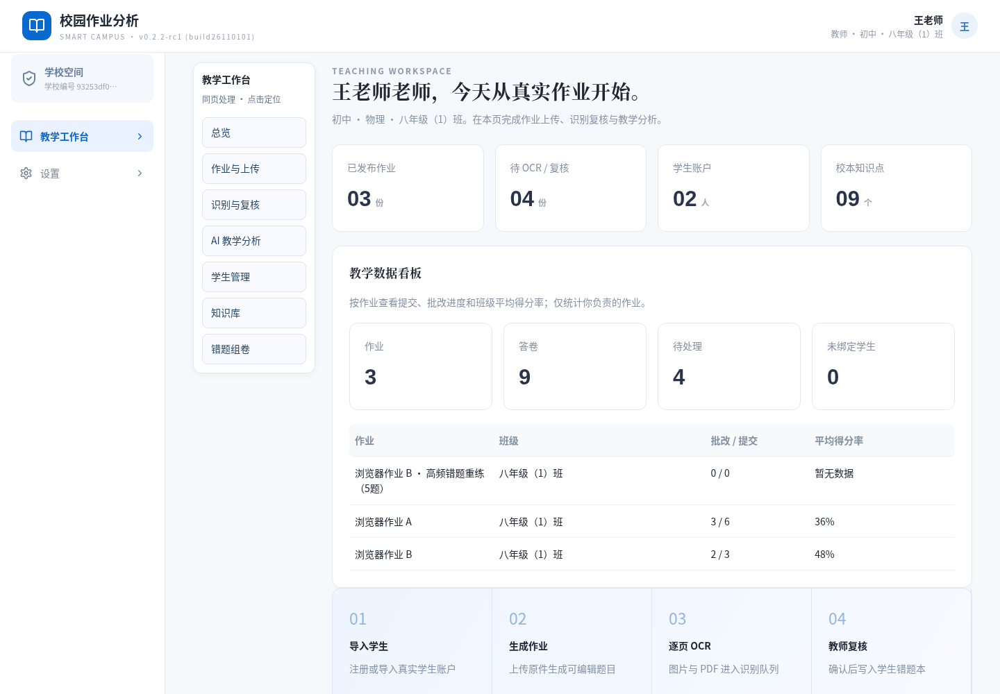
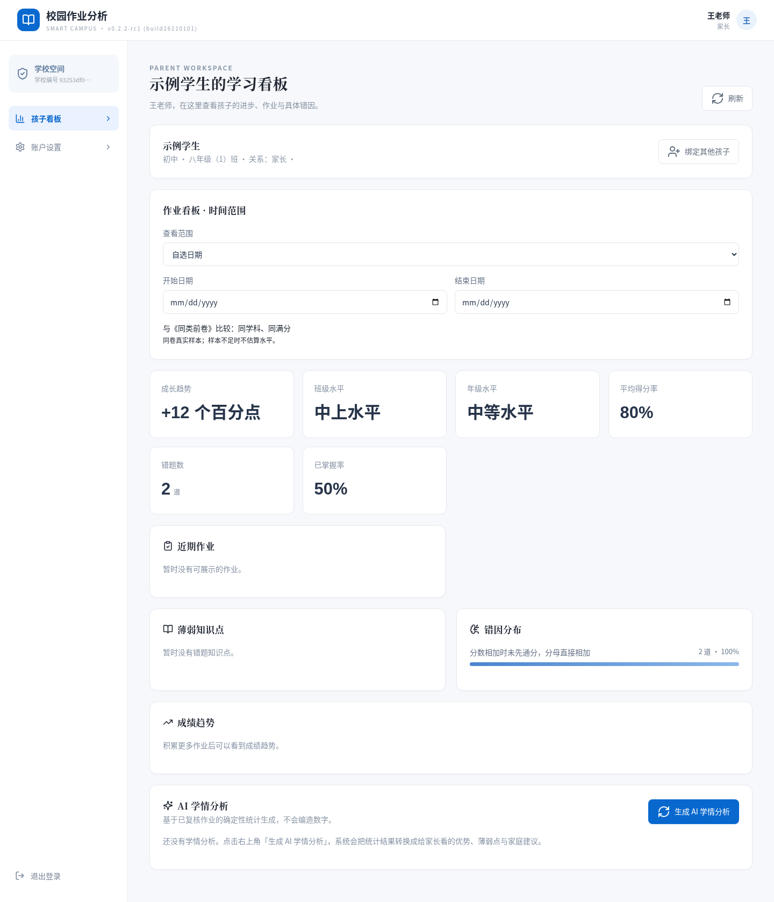

# MES-Homework v0.2.2-rc1（build26110101）

## 本次变更

1. **逐题等级**：得分率 ≥95% 为 A+、≥85% 为 A、≥75% 为 B+、≥60% 为 B，其余 C。缺失或无效分值显示“待评定”。复核页保留数值输入以支持教师精确纠正。
2. **目录与字体**：桌面端将章节目录固定在内容左侧，当前章节高亮；窄屏保留横向目录。标题、正文、数字采用不同字体族及清晰层级，沿用系统字体回退，不依赖外网字体。
3. **有题有图的组卷**：原题按文字、独立附图保存；支持受限矢量图和教师补充的 PNG/JPG/WebP 原题图形（每张最多 250 KB），发布、打开作业、错题组卷和打印均保留附图与作答区。不会用页面截图代替题目。教学分析重新布置原题时复制附图。
4. **教师 AI 教学分析**：已复核但没有错题的题库作业也能生成巩固建议。直接批改答卷复核后可生成本份答卷的教学分析，并保存到该答卷；不会将不同原卷题号合并为班级统计。
5. **家长进步与水平**：显示相同学科、相同满分的上一份试卷得分率变化，并明示比较依据。班级和年级水平由同标题、同学科、同学段、同满分试卷的实际学生样本计算，每人取最近一次，至少 5 人；不显示其他学生身份。排名按高于自己的样本占比划分：<10% 拔尖、<35% 中上、<70% 中等，其余中下。同分使用同一档。
6. **细化错因**：家长端展示批改记录中的具体错误描述，缺少具体描述时才使用通用错因类别。
7. **客观题答案**：解析提示要求选择、填空题仅输出答案；已明确题型的参考答案在落库前清除独立的“评分要点/标准”段落，主观题继续保留评分要求。
8. **家长看板简化**：移除“已复核作业”统计卡片，保留作业明细与既有可见权限边界。
9. **移除学科表现**：看板和 AI 学情分析展示均移除该板块。
10. **时间范围**：总览、本周、上周、自选起止日期；自然周按北京时间周一至周日，统计与作业列表一起更新。
11. **学生自动关联**：识别卷面姓名后，只在本校、作业学段与班级内唯一匹配；既有账号关联不被 OCR 覆盖。无法辨认或班内同名时，教师可在答卷中手动关联，已存在错题会同步归属。
12. **教师数据看板**：展示作业、答卷、待处理、未绑定学生数量，以及各作业提交/批改进度和平均得分率；按教师身份隔离。
13. **移除 OAuth**：生产入口不加载授权或 OAuth 模型调度，设置页仅保留 API Key；历史 OAuth 模式启动时切回 API Key，旧加密记录保留以避免破坏历史数据库。
14. **操作简化**：通过目录按步骤操作；自动匹配为默认选择；未匹配时明确提示选择账号；模型配置集中到厂商、API Key 和高级设置。

## 数据与升级

新增 `question_figures` 表，以题目 ID 关联独立附图，沿用事务迁移并兼容旧数据库。不删除账号、作业或原始附件。旧题若没有保存独立附图，需要重新解析原件或由教师补充，程序不会补造历史图像。

同类试卷的“学科 + 满分”以及同卷的“标题 + 学科 + 学段 + 满分”属于可解释的近似匹配，不保证两次难度一致。跨班同卷请保持统一试卷标题。年级从明确包含“年级”的班级名称识别；无法识别或样本不足时显示“数据不足”。

升级后请确认 API Key 配置。模型测试均使用 mock，不代表已使用真实厂商账号完成付费推理验收。本次未构建或签署 MSI/DEB/RPM/PKG，也未部署到生产环境。

## 验证

CI 修复：题目编辑函数按字段类型接收值，支持题图对象与移除附图的 `null`；生产构建强制重新检查 TypeScript。已用全新依赖安装验证构建，并增加附图上传、移除、重新上传和发布的浏览器回归。

- `npm run build`：通过。
- `npm test`：53 个文件、539 项通过。模型并发预算测试显式使用 4 槽测试策略，不依赖执行机器的 CPU 配额。
- `npm run verify:teaching`：全部 API 校验通过。
- `PLAYWRIGHT_CHROMIUM_EXECUTABLE_PATH=/usr/bin/chromium npm run test:browser`：30 项通过。
- 最后补充的题图模型请求处理变更：相关 API、家长、等级与图片预算 46 项回归通过。
- `git diff --check`：通过。

测试仅使用合成学生数据，模型调用全部 mock。

